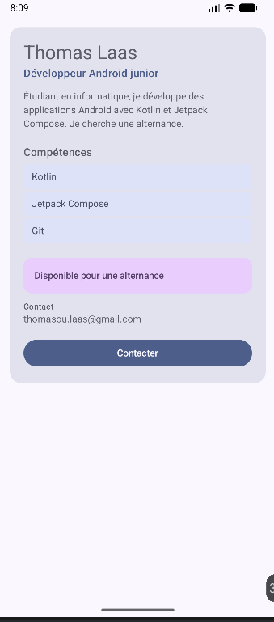

# Profil développeur Compose

## Description

Cette application affiche une fiche « Profil développeur » sur un seul écran Jetpack Compose.
La fiche présente un nom, un rôle, une courte description, une liste de compétences, une
disponibilité et une information de contact. Deux actions sont proposées : une zone cliquable
« disponibilité » et un bouton « Contacter ». Le bouton ouvre l'application e-mail ; la zone de disponibilité n'a pas encore d'action (callback vide).
Deux previews montrent deux profils différents (Android junior disponible, full-stack non disponible).

## Notions utilisées

- fonctions composables et arbre de composition ;
- paramètres et composants réutilisables ;
- callbacks (`onClick`, `onContactClick`, `onAvailabilityClick`) ;
- `Modifier` avec le paramètre `modifier: Modifier = Modifier` ;
- chaînage de modifiers (`fillMaxWidth`, `clickable`, `semantics`) ;
- padding externe / padding interne ;
- accessibilité de base (`Role.Button`, `onClickLabel`, `contentDescription`) ;
- `Scaffold` et `innerPadding` ;
- `@Preview` (deux variantes).

## Explication courte

1. **Composables créés** : `ProfilScreen`, `ProfilCard`, `ProfilHeader`, `SkillItem`,
   `InfoSecondaire`, `AvailabilityZone`, `ActionButton` (plus les deux previews).
2. **Écran principal** : `ProfilScreen`, appelé depuis `MainActivity` dans le `Scaffold`.
3. **Padding externe** : dans `ProfilScreen`, qui passe `Modifier.padding(16.dp)` à `ProfilCard`
   pour placer la fiche dans l'écran. Les `Modifier.padding(top = ...)` passés par `ProfilCard`
   à `AvailabilityZone`, `InfoSecondaire` et `ActionButton` sont aussi des paddings externes.
4. **Padding interne** : dans `ProfilCard` (`Column(Modifier.padding(20.dp))`), dans `SkillItem`
   (autour du texte) et dans `AvailabilityZone` (`padding(16.dp)`). Ils espacent le contenu
   par rapport au bord du composant, alors que le padding externe espace le composant par
   rapport à ses voisins.
5. **Callbacks** : `ActionButton` reçoit `onClick`, `AvailabilityZone` reçoit `onClick`, et
   `ProfilScreen` et `ProfilCard` les transmettent. Le composant signale le clic, c'est le
   parent qui décide quoi en faire. `MainActivity` branche `onContactClick` sur `envoyerEmail`, qui
   ouvre un e-mail avec un `Intent`.
6. **Accessibilité** : `AvailabilityZone` est une zone cliquable personnalisée. Elle déclare
   `role = Role.Button`, un `onClickLabel` (« Voir le détail de la disponibilité ») et une
   `contentDescription` qui lit la disponibilité et indique qu'on peut appuyer. `ActionButton`
   utilise un `Button`, qui expose déjà le rôle bouton et son texte aux lecteurs d'écran.
7. **Réutilisabilité** : chaque composable reçoit ses données en paramètres (texte, liste,
   callback) au lieu de les écrire en dur, et accepte un `modifier` que le parent peut
   utiliser. Les deux previews prouvent qu'on peut afficher des profils différents avec les
   mêmes composants.

## Capture d'écran

